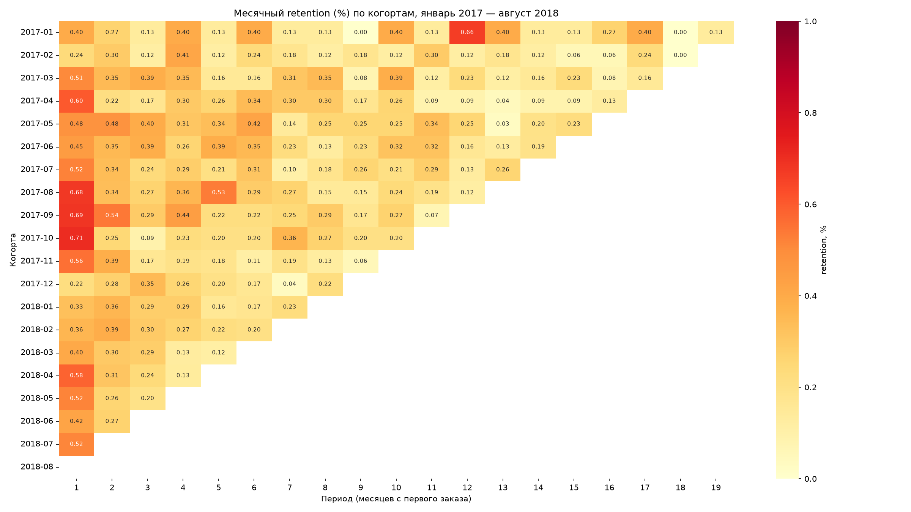
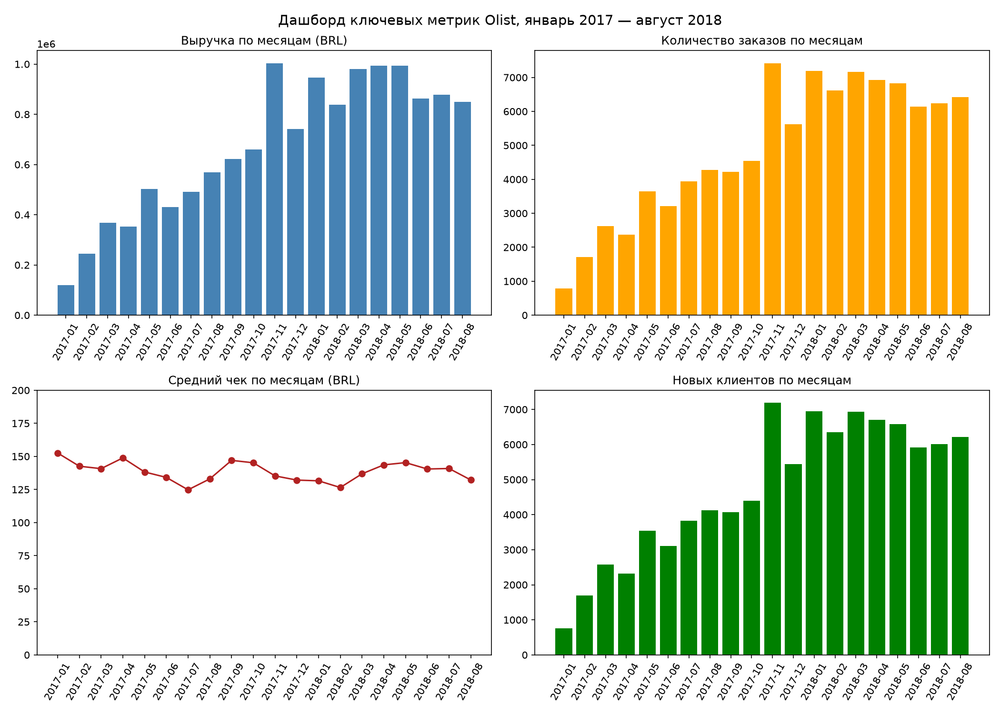

# Анализ маркетплейса Olist 🛒

Анализ поведения клиентов бразильского маркетплейса Olist.
Выручка стоит на месте: ищем причины и точки роста.

## Задачи
1. 📊 Когортный анализ: месячный retention
2. 🎯 Оценка Product/Market Fit
3. 📈 Ключевые метрики для роста выручки
4. 💡 Приоритизация гипотез по ICE
5. 🔬 Метрики и дизайн эксперимента для выбранной гипотезы
6. 📝 Отчёт и рекомендации для продакт-менеджера

## Главные выводы
- **Клиенты не возвращаются.** 97,9% покупателей ни разу не пришли снова. Retention первого месяца — **0,48%**, дальше кривая выходит на плато около 0,2%. PMF с точки зрения удержания нет.
- **Выручка держится на новых клиентах.** На повторные заказы приходится всего 1,8% выручки. Выручка росла весь 2017 год вместе с притоком новых клиентов, а с января 2018 стоит на уровне 0,84–0,99 млн BRL в месяц.
- **Приток новых клиентов снижается:** с марта по август 2018 их стало примерно на 10% меньше. Это стоит около 120 тыс. BRL выручки в месяц.
- **Средний чек стабилен** (около 137 BRL), проблема не в нём.
- **Рекомендации:**
  1. Главное — найти, в каких каналах привлечения просел приток новых клиентов (нужны данные маркетинга).
  2. Параллельно — дешёвый A/B/C-тест email/push-напоминания после первого заказа (через 30 или 60 дней): вернувшиеся клиенты приходят в среднем через 75 дней. Основная метрика — доля новых клиентов, вернувшихся за 90 дней, цель — удвоение с 1,29% до 2,6%. Даже такой успех даст около +1,3% выручки, поэтому это дополнение, а не решение.




## Самопроверка (версия 2)
Перепроверив первую версию анализа, я нашёл и исправил методологические ошибки:

| Что | Было | Стало | Причина |
|---|---|---|---|
| Retention первого месяца | 5,45% | **0,48%** | Простое среднее по когортам: когорта декабря 2016 из одного клиента с retention 100% весила как когорта из 7 000 человек. Теперь среднее взвешенное. |
| Период анализа | все месяцы, только `delivered` | январь 2017 — август 2018, все состоявшиеся заказы | 2016 год и сентябрь–октябрь 2018 неполные, а недоставленные заказы занижали конец периода. |
| Остановка роста выручки | предположение | подтверждена | Разница между «delivered» и всеми заказами 1–3%, плато длится 8 месяцев. |
| Доля клиентов с одним заказом | 98,2% | **97,9%** | Первая версия считала календарные месяцы и не видела возвратов в том же месяце. Подсчёт по заказам (97,0%) ошибается в другую сторону: считает возвратом покупку, записанную несколькими заказами. Правильно — клиенты, ни разу не вернувшиеся в другой день. |
| Время до повторного заказа | 26 дней | **75 дней** | Медиана считалась только по вернувшимся в соседний календарный месяц, где разрыв не больше двух месяцев. По всем вернувшимся выходит 28 дней, но только из-за заказов, оформленных в те же минуты, что и первый. Без них медиана 75 дней. |
| Главный рычаг роста | напоминания | приток новых клиентов | Эффект напоминаний в деньгах: даже удвоение возвратов — около +1,3% выручки, а падение притока стоит примерно в 10 раз больше. |

## Данные
[Brazilian E-Commerce Public Dataset by Olist](https://www.kaggle.com/datasets/olistbr/brazilian-ecommerce) (Kaggle): заказы, клиенты, товарные позиции за 2016–2018 годы. Используются три таблицы:
- `olist_customers_dataset.csv`
- `olist_orders_dataset.csv`
- `olist_order_items_dataset.csv`

Данные в репозиторий не входят.

## Технологии
- Python 3.10+
- Pandas, NumPy
- Matplotlib, Seaborn
- Jupyter Notebook

## Как запустить
1. Клонировать репозиторий:
   ```bash
   git clone https://github.com/AzamatNag/olist-marketplace-analysis.git
   cd olist-marketplace-analysis
   ```
2. Установить зависимости:
   ```bash
   pip install -r requirements.txt
   ```
3. Скачать датасет с [Kaggle](https://www.kaggle.com/datasets/olistbr/brazilian-ecommerce) и положить три CSV из списка выше в папку `data/`.
4. Открыть `olist_analysis.ipynb` в Jupyter и выполнить все ячейки. Графики сохраняются в папку `images/`.
